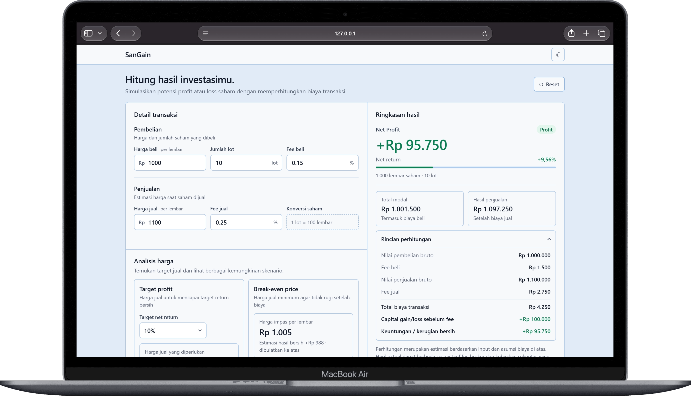
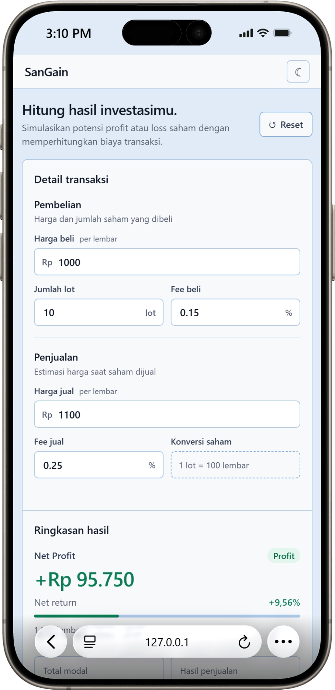

# SanGain – Stock Profit Calculator

## Preview

### Desktop View
The desktop version of SanGain, featuring the main stock profit calculator interface.



### Mobile View
The responsive mobile version of SanGain, optimized for a seamless experience on smaller screens.



SanGain is a stock profit and loss estimation calculator designed for the Indonesian stock market (IDX/BEI). It calculates transaction results after applying customizable buy and sell broker fees, with additional target price and break-even analysis tools.

*SanGain adalah kalkulator estimasi keuntungan dan kerugian saham untuk pasar Indonesia (IDX/BEI). Aplikasi ini menghitung hasil transaksi setelah memperhitungkan biaya broker beli dan jual yang dapat disesuaikan, serta menyediakan fitur analisis harga target dan break-even.*

The application runs entirely in the browser, without a backend, framework, or JavaScript dependencies.

*Aplikasi berjalan sepenuhnya di browser, tanpa backend, framework, atau dependency JavaScript.*

## Features | Fitur

- **Real-time Profit/Loss Calculation** – Calculates net profit or loss instantly.
  *Menghitung keuntungan atau kerugian bersih secara langsung.*
- **Indonesian Stock Lot Conversion** – 1 lot = 100 shares.
  *Konversi lot saham Indonesia (1 lot = 100 lembar).*
- **Customizable Broker Fees** – Adjustable buy and sell fees (default: 0.15% and 0.25%).
  *Biaya broker beli dan jual yang dapat disesuaikan (default: 0,15% dan 0,25%).*
- **Transaction Breakdown** – Displays total capital, gross transaction value, fees, and sale proceeds.
  *Menampilkan rincian modal, nilai transaksi bruto, biaya, dan hasil penjualan.*
- **Target Profit** – Calculates the selling price required to achieve a specific net return (5%, 10%, 15%, 20%, or custom).
  *Menghitung harga jual yang dibutuhkan untuk mencapai target return bersih (5%, 10%, 15%, 20%, atau custom).*
- **Break-even Price** – Calculates the minimum selling price required to avoid a loss.
  *Menghitung harga jual minimum agar tidak mengalami kerugian.*
- **Quick Profit Simulation** – Provides seven selling price scenarios ranging from -5% to +15%.
  *Menyediakan tujuh skenario perubahan harga jual dari -5% hingga +15%.*
- **Input Validation** – Clear error messages and reset functionality.
  *Validasi input dengan pesan kesalahan yang jelas dan fitur reset.*
- **Light and Dark Themes** – Supports system preferences and manual switching.
  *Mendukung mode terang dan gelap, mengikuti preferensi sistem serta penggantian manual.*
- **Local Storage** – Automatically saves the latest input values in the browser.
  *Menyimpan input terakhir secara otomatis di browser.*
- **Responsive Layout** – Optimized for desktop and mobile devices.
  *Tampilan responsif untuk laptop dan perangkat mobile.*

## Technology Stack | Teknologi

- HTML5
- CSS3 (Custom Properties for theming)
- Vanilla JavaScript (ES Modules)
- `Intl.NumberFormat` for Rupiah and percentage formatting
- [Plus Jakarta Sans](https://fonts.google.com/specimen/Plus+Jakarta+Sans) via Google Fonts, with system font fallbacks.

## Project Structure | Struktur Project

```text
sangain/
├── assets/
│   ├── fonts/
│   ├── icons/
│   └── images/
├── css/
│   ├── reset.css
│   ├── variables.css
│   ├── layout.css
│   ├── components.css
│   ├── calculator.css
│   └── responsive.css
├── js/
│   ├── main.js
│   ├── calculator.js
│   ├── fees.js
│   ├── formatter.js
│   ├── validation.js
│   └── ui.js
├── index.html
├── README.md
├── LICENSE
└── .gitignore
```

The `assets/` directory is reserved for images, icons, and locally hosted fonts. It is currently unused.

*Folder `assets/` disiapkan untuk gambar, ikon, dan font lokal. Saat ini belum digunakan.*

## Installation and Run | Instalasi dan Menjalankan

1. Clone or download this repository.
   *Clone atau unduh repository ini.*
2. Open the project folder in your preferred code editor.
   *Buka folder project di editor kode.*
3. Start a local HTTP server from the project root. ES Modules cannot be loaded properly through the `file://` protocol.
   *Jalankan local HTTP server dari root project. ES Modules tidak dapat dimuat dengan benar melalui protokol `file://`.*

Example using Python:

```bash
python -m http.server 8000
```

4. Open `http://localhost:8000` in your browser.
   *Buka alamat tersebut di browser.*

No build process or dependency installation is required.

*Tidak diperlukan proses build maupun instalasi dependency.*

## Usage | Cara Penggunaan

1. Enter the purchase price and number of lots.
   *Masukkan harga beli dan jumlah lot.*
2. Enter the selling price you want to simulate.
   *Masukkan harga jual yang ingin disimulasikan.*
3. Adjust the buy and sell fees according to your broker's rates.
   *Sesuaikan fee beli dan fee jual dengan tarif sekuritas yang digunakan.*
4. Review the net profit/loss summary and transaction breakdown.
   *Periksa ringkasan profit/loss bersih dan rincian transaksi.*
5. Use Target Profit, Break-even Price, and Quick Profit Simulation to analyze different selling prices.
   *Gunakan Target Profit, Break-even Price, dan Quick Profit Simulation untuk menganalisis berbagai harga jual.*
6. Click **Reset** to restore the default values or use the theme toggle in the top-right corner.
   *Klik Reset untuk mengembalikan nilai awal atau gunakan tombol pengaturan tema di pojok kanan atas.*

## Calculation Notes | Catatan Perhitungan

- 1 lot = 100 shares.
  *1 lot = 100 lembar saham.*
- Total Capital = Gross Purchase Value + Buy Fee.
  *Total Modal = Nilai Beli Bruto + Fee Beli.*
- Sale Proceeds = Gross Selling Value − Sell Fee.
  *Hasil Penjualan = Nilai Jual Bruto − Fee Jual.*
- Net Profit/Loss = Sale Proceeds − Total Capital.
  *Profit/Loss Bersih = Hasil Penjualan − Total Modal.*
- Net Return = Net Profit/Loss ÷ Total Capital × 100%.
  *Return Bersih = Profit/Loss Bersih ÷ Total Modal × 100%.*
- Target and break-even prices are rounded up to the nearest whole Rupiah.
  *Harga target dan break-even dibulatkan ke atas ke Rupiah penuh.*

Default broker fees are estimates and may vary between securities companies. Always check the actual rates and fee components applied by your broker.

*Fee broker default merupakan estimasi dan dapat berbeda antar sekuritas. Periksa tarif dan komponen biaya aktual pada broker masing-masing.*

The calculation only includes the buy and sell fees entered by the user. Taxes and other charges are not calculated separately. If your broker separates the final sales tax, include it in the sell fee percentage.

*Perhitungan hanya memasukkan fee beli dan fee jual yang diinput pengguna. Pajak atau biaya lain tidak dihitung terpisah. Jika broker memisahkan pajak penjualan final, gabungkan ke dalam persentase fee jual.*

Stock price tick sizes and exchange auto-rejection limits are not validated.

*Fraksi harga saham dan batas auto rejection bursa tidak divalidasi.*

### Example | Contoh

Buying 10 lots at Rp 1,000 and selling at Rp 1,100, with a 0.15% buy fee and a 0.25% sell fee:

*Membeli 10 lot pada harga Rp 1.000 dan menjualnya pada harga Rp 1.100, dengan fee beli 0,15% dan fee jual 0,25%:*

| Component | Value |
|---|---:|
| Total Capital | Rp 1,001,500 |
| Sale Proceeds | Rp 1,097,250 |
| Net Profit | Rp 95,750 (+9.56%) |
| Break-even Price | Rp 1,005 per share |

## Limitations | Batasan

- The application only simulates a single buy transaction and a single sell transaction. Multiple purchases with average cost calculations are not supported.
  *Aplikasi hanya menyimulasikan satu transaksi beli dan satu transaksi jual. Pembelian bertahap dengan perhitungan harga rata-rata belum didukung.*
- The font is loaded from Google Fonts, so an internet connection is required to display the intended typography. Without an internet connection, the browser will use a system font fallback.
  *Font dimuat dari Google Fonts sehingga membutuhkan koneksi internet untuk menampilkan tipografi sesuai desain. Tanpa koneksi internet, browser akan menggunakan font sistem.*
- Results are estimates and should not be considered investment advice.
  *Hasil merupakan estimasi dan bukan merupakan saran investasi.*

## License | Lisensi

This project is proprietary and protected by copyright. All rights reserved. No permission is granted to copy, modify, or redistribute the source code without prior written permission from the copyright holder.

*Project ini merupakan karya yang dilindungi hak cipta. Seluruh hak dilindungi. Tidak ada izin untuk menyalin, memodifikasi, atau mendistribusikan ulang source code tanpa persetujuan tertulis dari pemegang hak cipta.*

See the [LICENSE](LICENSE) file for details.

*Lihat file [LICENSE](LICENSE) untuk informasi lebih lanjut.*
